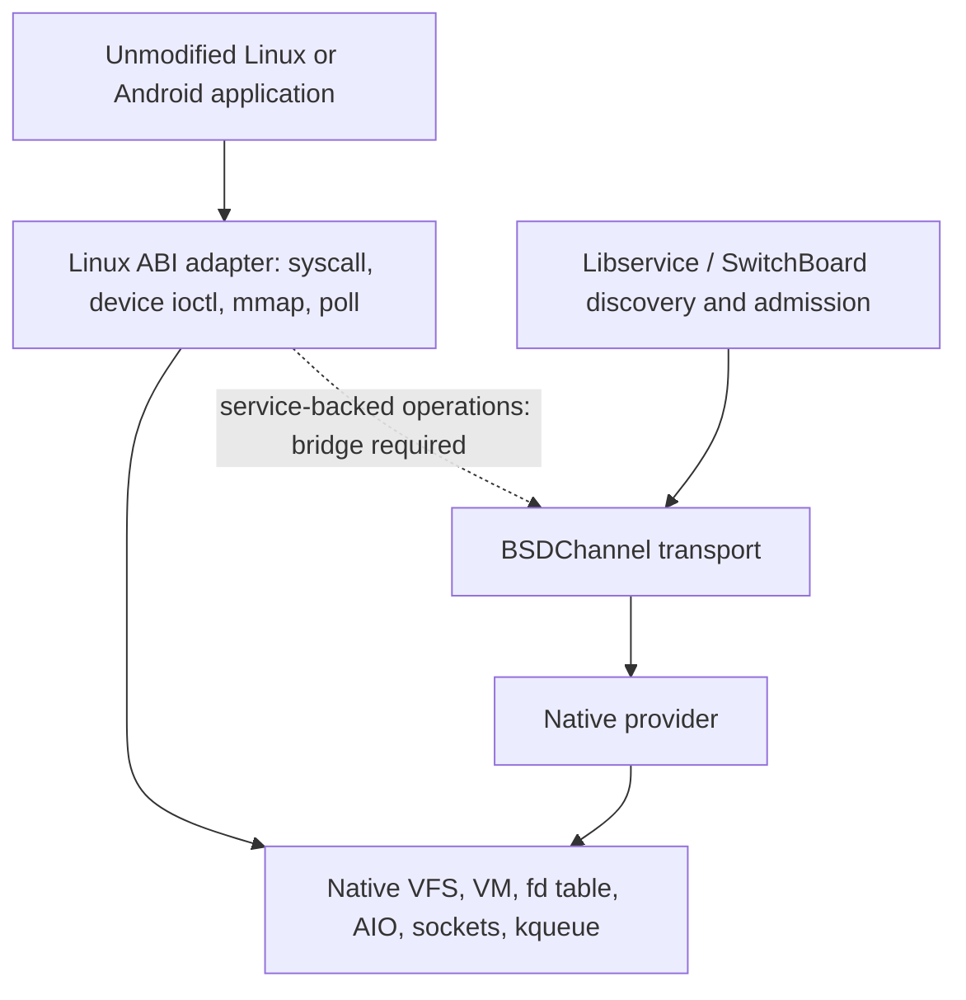

# Starnix reference inventory for the Linuxulator

Provenance for reused test ideas and implementation references is maintained
in [the contributed software register](../contrib/README.5BSD), under
"Fuchsia Starnix Linuxulator references". Update that entry with each reuse.

Architecture-specific Linux64 coverage and the RISC-V backend gap are
recorded in [Linuxulator architecture parity](linuxulator-architecture-parity.md).

## 2026-10-16 follow-up: descriptor modes, PTY locks and FUSE page limits

The current source tree implements three additional contracts from the Starnix
review. Linux `/proc/<pid>/fd/N` and task descriptor links now report
0500/0300/0700/0000 for read, write, read-write and `O_PATH` descriptors.
The attribute callback holds the process across a descriptor lookup and
rechecks access while taking a file reference. Linux-created PTYs start
locked; `TIOCSPTLCK` and `TIOCGPTLCK` now change and report the master lock,
and every new slave open enforces it, including `TIOCGPTPEER`. Native PTYs
retain their initial unlocked state. FUSE 7.28+ now advertises `MAX_PAGES`,
uses 32 pages for a zero-page daemon reply and caps read/write request sizes by the
negotiated page count while preserving the mount's `max_read` remount check.

The freestanding Linux procfs and PTY tests now cover the new modes and lock
transitions. Native FUSE read/write tests exercise a four-page limit smaller
than the advertised `max_read` and `max_write`. These are source and test
changes; no kernel runtime acceptance is claimed until a matching kernel,
modules and test suite have been built and run.

## Scope correction: whole-tree feature review (2026-10-10)

### User-selected execution order and current batch

1. Procfs/socket/TTY/input fixes and test parity.
2. FUSE operation/option gaps and tests. The ext4 drive/image detour was
   cancelled by the user.

Binder/binderfs and io_uring are deferred by user request (2026-10-10).
Retain their inventory and reference probes for future work; neither is an
active implementation or acceptance requirement for this batch.

This selection supersedes the broader suggested ordering later in the review.
The remaining surveyed areas stay in the inventory but are not prerequisites
for the two active batches. No Binder or io_uring backend has been implemented by
the current work.

Initial batch (historical; superseded by VM results below): `linux_ioctl.c` now handles evdev name/physical/unique queries
with zero capacity and bounds copyout by the returned length. The synthetic
uinput fixture and Linux probe compile; root-only runtime checks await the VM.
Two Starnix-derived terminal cases (input flush and packet-mode behavior) pass
on the installed host, both raw and through their ATF wrapper. Three native
FUSE malformed-header tests compile and are registered; their runtime gate is
pending. GENERIC kernel/modules build passed using 16 CPUs under `/usr/obj`.
Earlier socket/procfs regressions remain in the desktop VM checklist.

Follow-up: native FUSE now validates daemon error ranges before negation to
avoid signed overflow for INT32_MIN. Six errno-mode regression cases build;
VM runtime acceptance is pending. Binder qualification has begun with eight
freestanding cases in `linux_binder_reference.c` (commands, mapping protection,
inherited descriptors and version). They compile but still need a dedicated
Linux Binder reference run. A Binder implementation is not yet enabled.

### Low/medium completion criteria

**Selected review/fix/test batch qualified (2026-10-10).** The original
completion checklist has been reconciled against case lists, manifests,
current test sources and recorded VM results. Full native Kyua now passes
all890 active GTest cases plus the decoder and32 repeated queue checks.
The CTL integration case is explicitly skipped for unavailable external
tools. Remaining backend and VM dependencies are listed below; they are
not implemented or qualified by these passing counts. Evidence root:
`/usr/obj/5BSD-starnix-fuse-vm-20261010/prebinder-completion-audit.json`.

| Completion requirement | Verified evidence / disposition |
|---|---|
| Kernel/module/source identity, filesystem, commands, results and retained failures | Each gate has manifests, console and result records. Failed ATF/snapshot/FUSE runs remain preserved. Current procfs, uinput and57 FUSE test-source hashes match their latest qualification inputs. |
| Broader Linuxulator gate plus selected ATF wrappers | `broad-gate1` passes every expected set and123 artifact hashes; `atf11` passes98/98 on ZFS/tmpfs. Snapshot additions pass16/16; uinput additions pass12/12. Rechecking these ATF logs against exact cases/manifests succeeds. |
| Native FUSE under Kyua metadata | `fuse-kyua3`:50 programs pass,890/890 active GTests plus decoder; no internal GTest skips. Required unprivileged permission cases pass. One recorded CTL skip requires fuse-ext2/mkfs.ext2. All59 artifact hashes and clean shutdown/QEMU0 verified. |
| FUSE polling failure resolved | Verbose trace identified MAC GETXATTR prerequisites; setup now loads labels with stat and leaves attribute TTL0. Full gate plus32 additional repetitions pass exact1/2/1 queue counts. |
| FUSE options/backend review | INIT/operation tables distinguish native coverage and remaining ACL, umask, passthrough, async readiness, splice and VFS rename contracts. Linux-entry NOREPLACE passes21/21 native+Linux cases; actual kernel NFS cookie tests pass both PLUS/fallback cases and are included in latest Kyua. |
| Procfs/socket/TTY/input comparison and uncovered feasible fixes | Tests cover adopted seek/snapshot, translated sockopts/buffers, terminal flags/packets/flush, evdev/uinput setup/state/delivery/copy faults. The additional contract table records missing backend semantics and source evidence. |
| Inotify ordering with lifetime regressions | Native82/82, parent-path126/126, Linux64 mapping580/580 plus18 native cases, and expanded ATF ordering cases pass. FUSE forced-unmount stress512/512 and vnode replacement256 repetitions supply separate teardown coverage. |
| Provenance and next-VM instructions | Existing `contrib/README.5BSD` maps adopted references and local follow-ups; Desktop checklist records commands, outcomes, superseded failures and remaining dependencies. |
| Deferred/cancelled scope | Binder/binderfs and io_uring remain deferred; ext4 remains cancelled. No host upgrade or reboot. Compilation uses six jobs. |

The native Kyua and uinput gates use GENERIC#11. Broader Linuxulator
qualification uses snapshot-fixed#10; historical results retain their own
kernel/module identities. There is no claim that every historical matrix ran
on the newest image. Modular pseudofs unload and quantitative snapshot leak
qualification remain separate from the passing forced-unmount/close tests.


Broader Linuxulator qualification: **PASS**, `broad-gate1/results.json`
under `/usr/obj/5BSD-starnix-fuse-vm-20261010`. The maintained host gate
accepts every expected case set, all123 artifact hashes, no nonzero result
rows or rejected kernel diagnostics, healthy ZFS and clean poweroff/QEMU
exit0. This run uses the snapshot-fixed GENERIC kernel and matching modules.
It includes102 unshare executions plus capability mode, legacy AIO, ptrace,
quota, sockets/events, rseq/perf, OFD/seals and filesystem resolution tests.
It does not qualify Binder, io_uring, NFS export-cookie integration, external
CTL-over-FUSE dependencies or the explicitly unimplemented FUSE backends.


ATF11 qualification: **98/98 PASS** on ZFS/tmpfs, exact artifact hashes
and case sets, no skips/failures, healthy ZFS and clean poweroff with terminal
QEMU exit0. Evidence: `atf11-results.json` and `atf11-console.log` under
`/usr/obj/5BSD-starnix-fuse-vm-20261010`, using `prebinder-atf10-manifest.json`
and `atf10-cases.json`. This closes the earlier expanded matrix, including
memfd/unshare corrections. The new uptime snapshot regression below was added
after that image was built and remains outside this acceptance result.

Procfs snapshot qualification: **16/16 PASS** in `procfs-snapshot2-results.json`,
eight cases each on ZFS/tmpfs, exact source/kernel/module hashes and case sets,
no skips or failures, healthy ZFS and clean poweroff/QEMU exit0. The regression
rewritten from Starnix `ProcUptimeTest.UptimeByChar` fails on the installed
kernel and passes with the new opt-in per-open pseudofs/linprocfs snapshot.
Linux6.12.110-0-lts also passes all six expanded reference cases. VM coverage
includes dup/fork lifetimes, seek/reopen refresh, the existing procfs/boot-id
cases, and native forced-unmount cleanup (16 mounts/512 descriptors per
filesystem). Revised GENERIC build/private staging use six build jobs.
The first snapshot VM's ATF listing failure is retained; its duplicate
metadata was corrected before this run. Modular-kernel unload and quantitative
leak freedom are separate unqualified claims. ATF11's earlier 98-case result
is retained independently and does not include these additions.

Kernel NFS cookie qualification: **2/2 PASS**, `nfs-cookie2-results.json`.
The actual kernel NFSv3 server reads the exported mock FUSE directory with
UIO_SYSSPACE and cookie arrays. Both PLUS and ENOSYS fallback preserve exact
names, inode numbers and nonconsecutive64-bit cookies across small replies.
All7 artifact hashes match; healthy ZFS, synced buffers and clean poweroff
with QEMU exit0. The first fixture failure (missing STATFS response) remains
recorded. This closes the dedicated NFS cookie integration requirement.

Status convention: the latest qualification paragraphs below supersede older
build-only and pending-runtime notes. Those later historical notes retain the
sequence of observed failures and fixes; they are not a second acceptance list.
The remaining-contract table distinguishes verified coverage from backend and
integration dependencies. Binder and io_uring remain deferred.

Latest native/parent qualification (2026-10-10): **native4 passes82/82**
on ZFS/tmpfs, including native private-map data survival and the descriptor
path fixture. **Parent2 passes126/126** on ZFS/tmpfs/nullfs as root and
unprivileged, with zero retained watches/paths. Both have exact hashes and
clean shutdown evidence. This closes those baseline matrices. The expanded
Linuxulator ATF gate now passes98/98; a dedicated Linux-on-FUSE NOREPLACE
gate now passes **21/21** (15 native rename cases and six Linux-entry cases)
with exact kernel/module/helper/test hashes and clean shutdown. Evidence:
`linux-rename2/results.json`. The Linux helper covers the syscall entry
through FUSE LOOKUP/RENAME2, error translation and remembered fallback state.

Expanded ATF gate status (2026-10-10): ATF10 passes all 49 ZFS cases,
including corrected unshare fixtures and memfd offsets, but the host's
1200-second timeout interrupts tmpfs after its original 28 cases. No
complete tmpfs report or clean shutdown exists, so acceptance is rejected.
ATF11 reruns the identical image/manifests with a 3600-second deadline;
`atf11-inputs.json` records the association. The full 98-case requirement
is unchanged. Native3 finishes 81/82; its sole native tmpfs private-mapping
failure exposed the ordinary-native versus Linux64 reference-lifetime
distinction documented below. Native4 checks the corrected native baseline
and mapped data survival. Mapping2 passes all 580 Linux64 executions and
18 native cases with the strengthened data-survival assertion, exact
hashes, watch count 0 -> 0 and clean shutdown; evidence is in `mapping2/`.

Linux64 mapping qualification (2026-10-10): `mapping1/results.json` under
`/usr/obj/5BSD-starnix-fuse-vm-20261010` passes **580/580 Linux64 executions
and 18/18 native cases**, with exact artifact hashes, watch count 0 -> 0,
both filesystem mounts and clean shutdown. All ten Linux64 tmpfs private-map
executions pass (five rounds each as root and unprivileged). The ordinary
native tmpfs private-map distinction was subsequently qualified by native4:
`vn_mmap` explicitly retains open descriptions for Linux64 mappings, while
ordinary native vnode mappings use their pager's reference lifetime.

FUSE acceptance coverage reconciliation (same pinned Starnix revision):
run-11's 888 passing cases include `interrupt` (10), `forget` (3), `cache`
(20), `notify` (42), `default_permissions` (60), `allow_other` (6), `locks`
(30), `read` (51), `write` (53) and `destroy` (5). These counts identify
existing native regression coverage, not newly imported tests or universal
proof of all races. The separate 512-race teardown run and vnode-leak check
remain additional evidence. `FuseInitFlags` in Starnix's `modules/fuse/lib.rs`
lists BIG_WRITES, DONT_MASK, SPLICE_*, PLUS/AUTO, SETXATTR_EXT, POSIX_ACL,
PASSTHROUGH and INIT_EXT. Its list does not supply implementations for every
flag absent from native INIT. Native exclusions such as ATOMIC_O_TRUNC,
AUTO_INVAL_DATA, ASYNC_DIO, PARALLEL_DIROPS, HANDLE_KILLPRIV, CACHE_SYMLINKS
and MAX_PAGES must be assessed individually; advertising them alone would
not implement their contracts. ACL authority, passthrough file ownership,
frame-aware splice and asynchronous mounted-file poll remain backend work.
The separate `tests/sys/fs/fusefs/ctl.sh` case is a native SCSI CTL LUN
regression using a FUSE-backed file, not Linux fusectl coverage. It needs
`fuse-ext2` and `mkfs.ext2`; that native integration check remains pending
with explicit external dependencies. It does not require adding ext4 support.

Latest follow-up (2026-10-10): native FUSE run-11 passes **888/888** on
the memfd-fixed kernel, with exact artifact hashes and clean shutdown.
The unshare ATF diagnostic identifies the cwd mismatch as `/compat/linux`
versus `/` in this guest. The BSD-subset probe now measures the selected root
pathname before cloning; the Linux-reference probe retains `/`. This preserves
sharing/detachment checks and does not establish pathname virtualization.
The corrected expanded Linuxulator matrix still requires runtime acceptance.

Linuxulator ATF qualification (2026-10-10): the seven selected wrappers ran
all 28 cases on ZFS and tmpfs. The first run reached **54/56 passes**;
the sole failing case on each filesystem was evdev `bitmap_bounds`: native
evdev handles EV_SYN implicitly but omitted it from the Linux event-type
bitmap. The corrected run now passes **56/56**, with exact cases, hashes,
filesystem placement and clean shutdown verified. All selected procfs,
socket, TTY, evdev/uinput and inotify cases passed on both filesystems.
Evidence: `atf8-results.json`/`atf8-console.log` under
`/usr/obj/5BSD-starnix-fuse-vm-20261010`. The wrappers now explicitly brand
their Linux ELF probes and no longer depend on the host fallback-brand setting.

Native VM follow-up (2026-10-10): the first mounted run exposed a pre-INIT
root GETATTR deadlock in the Veriexec mount hook. FUSE now supplies uncached
bootstrap root attributes, following its existing pre-INIT statfs behavior.
`GetattrBeforeInit.root_attributes_are_not_cached` passes in the matching VM
with Veriexec active. Native MAC label requests also require an explicit
`system.mac_abac`-absent response in the mock; the Access fixture restores
that expectation after clearing its defaults. Run-5 passes all **886 active
cases across 48 native programs**, with matching hashes, no unexpected skips
or kernel diagnostics, healthy ZFS and clean shutdown. Evidence is under
`/usr/obj/5BSD-starnix-fuse-vm-20261010/run-5`. This qualifies the native GTest
protocol gate. The selected Linuxulator/device ATF matrix also passes as
recorded above; separate ctl ATF, broader Linuxulator and extended teardown
stress requirements remain open.

Vnode lifetime follow-up: the existing `Lookup.vtype_conflict` test passed
while retaining one native vnode per inode-type replacement. The native
allocation path now releases its hash-lookup reference after reclaim.
`guest-fuse-vnode-lifetime.sh` runs 256 repetitions in an isolated VM and
checks the global vnode count as well as FUSE's private counter. Before the
fix the count grew by 257; the corrected VM stays at 80 (delta zero), with
256 passes and zero FUSE nodes. Evidence: `lifetime2-results.json` and its
manifest/console in the same VM directory. Full native protocol run-6 also
passes all 886 cases on the corrected module, with matching hashes and clean
shutdown. Its core kernel matches run-5/ATF8; the test binaries match run-5.

Forced-unmount follow-up: `Destroy.forced_unmount_pending_lookup` races a
successful LOOKUP reply against forced unmount. The first fixture assumed
graceful FORGET/DESTROY delivery; native forced purge terminates the session
before reclaim. The corrected test checks request completion/cancellation
and mount removal. `guest-fuse-teardown-stress.sh` passes 256 repetitions
with zero vnode growth, zero FUSE nodes and zero request tickets; hashes and
clean shutdown are verified in `teardown3-results.json` and its console and
manifest in the same VM directory. This samples scheduling and does not
prove every insertion-failure branch or READDIRPLUS teardown is covered.

READDIRPLUS teardown follow-up: `ReaddirPlus.forced_unmount_pending_reply`
adds a held second reply after a long-name entry fills most of the caller's
buffer. Two returned entries fit the requested wire size but exceed remaining
user capacity. The updated stress job passes **512/512 races** (256 LOOKUP,
256 PLUS), zero FUSE nodes and request tickets, and global vnode growth +4
within its isolated-job allowance of 16. Hashes and clean shutdown are
verified in `teardown8-results.json`, manifest and console. This adds the
20th PLUS case. Full native protocol run-10 also passes **888/888 active
cases**, with matching hashes and clean shutdown. Kernel/module match run-6;
only destroy/readdir artifacts changed. Scheduling stress does not establish
that every insertion-failure branch was reached.

Earlier regression integration: the selected ATF matrix now includes the
three adversarial files/epoll/pidfd wrappers and a new unshare wrapper for 17
supported-subset cases plus capability-mode rejection. All four wrappers
explicitly brand their Linux probes. This expands the target from 28 to
49 cases per filesystem (98 executions). ATF9 finished **86/98**, with the
same six failures on both filesystems; the expanded matrix is not qualified. All six ZFS failures
are in unshare. One epoll-rejection fixture incorrectly omitted CLONE_FS and
is corrected in source. A separate diagnostic confirms the shared-memory
backend rejects seeking beyond an empty memfd's EOF; cwd/exec failures remain
under investigation. Instrumented standalone cwd cases pass, so ATF-context
reproduction remains necessary. Case/hash manifests and failure logs are retained. The local
`verify-starnix-atf.py` checks exact case sets, statuses, hashes, filesystems
and clean shutdown; it accepts the earlier ATF8 log and rejects nine altered
failure variants. This does not replace unrelated broader ABI gate coverage.

Historical completion review (superseded by the qualified-batch audit above):
The Desktop `Fuchsia tests for next VM.txt` checklist now includes a consolidated
completion review in addition to the per-change commands. Acceptance requires
the matching-kernel Linuxulator gate and explicit ATF wrappers, native FUSE
regressions beyond malformed replies, and recorded failures/skips. The known
inotify `child_before_parent` now has a source fix and is a required pass;
its selected ATF cases now pass on both ZFS and tmpfs. The broader matching-kernel
Linuxulator gate now passes as recorded above.

The completed bounded review compares procfs/socket/TTY/input contracts
and FUSE negotiation, interrupt/forget, cache/mmap, permissions, teardown and
passthrough against the pinned reference. The tables below distinguish covered
contracts, fixes with regression evidence, and remaining backend dependencies. These are audit
targets, not assertions that the native features are absent. Binder reference
qualification does not establish a working Binder backend.

### Additional procfs/socket/TTY/input contract audit (2026-10-10)

Uinput event delivery now passes **12/12** in `uinput-events1-results.json`:
validation, lifecycle, ABS setup, key delivery, ABS delivery and invalid-copy
handling on both ZFS/tmpfs. Tests check SYN_REPORT readiness, exact event
payloads, held-key/axis state and drained-queue EAGAIN. Native `uinput_write`
now checks `uiomove` before pushing an event. The build uses six jobs; GENERIC
#11 and matching modules were installed only into the private VM staging root.
Source/kernel hashes, exact cases, healthy ZFS and clean QEMU exit0 are verified.
The earlier broad/protocol results retain their recorded kernel identities;
this focused run does not requalify every subsystem changed in the shared tree.

| Contract / pinned reference | Current native evidence and disposition |
|---|---|
| PTY peer open: `terminal_test.cc:IoctlTIOCGPTPEER` | Existing `tests/sys/kern/linux_pty.c` already checks data transfer, CLOEXEC, NONBLOCK/EAGAIN, access modes and bad descriptors. `linux_ioctl_tiocgptpeer` uses the native pts master and opens its slave path. This source comparison avoids duplicating those cases; it does not prove mount-independent peer opening. |
| PTY locking: `modules/devpts/lib.rs:TIOCGPTLCK/TIOCSPTLCK` | Reference stores/enforces lock state. Native `linux_ioctl.c:TIOCSPTLCK` only checks that the fd is a master; no GET lock case exists. Full support needs native pts lock state and slave-open enforcement, including the peer-open path. Remaining backend work; the current unlock compatibility path is not lock support. |
| `smaps`, `smaps_rollup`, `zoneinfo`: `modules/procfs/{pid_directory,proc_directory}.rs` | No matching file registrations exist in current linprocfs. Native-backed Linux memory-accounting definitions, consistent snapshots and access checks need design before exposing these views. Current maps/statm coverage does not qualify them. |
| `timerslack_ns`: `modules/procfs/pid_directory.rs` | Reference keeps task state and checks cross-task scheduler/capability access. Native `linux_misc.c` explicitly rejects PR_SET/GET_TIMERSLACK because storage/semantics are absent; no proc file exists. Needs a coherent timer/prctl/proc contract, not a writable placeholder. |
| proc `hidepid`/`gid`: `modules/procfs/fs.rs`, `ProcHidePidTest` | No corresponding option handling exists in linprocfs/pseudofs. Native visibility/debugger restrictions are a separate policy. Mount-local options must affect lookup, enumeration, held descriptors and remount behavior before claiming parity. |
| Socket filter/device binding: `socket_test.cc:BpfTest/BindToDevice` | `linux_socket.c` explicitly rejects SO_ATTACH_FILTER/SO_DETACH_FILTER/SO_LOCK_FILTER and SO_BINDTODEVICE. Native packet/filter and interface-visibility enforcement is required. Existing option truncation/buffer tests do not qualify these backends. |
| Input event delivery: `uinput_test.cc:WriteEVKEY/WriteEVABS` | Rewritten tests extend the reference's write checks with real evdev readback and state. The local invalid-copy regression exposed the ignored native copy error; fixed and qualified12/12 as above. Force-feedback handling remains unsupported as already recorded. |

These dispositions identify remaining subsystem work rather than claiming full
Starnix parity from the selected regression gates. No Binder/io_uring work or
ext4 support is included.

### Remaining FUSE INIT flags: pinned-source disposition

This comparison uses `modules/fuse/lib.rs` at the pinned revision and native
`sys/fs/fuse/fuse_internal.c:fuse_internal_init`. A protocol constant or a
daemon-advertised flag is not by itself an implementation to import.

| Contract | Pinned Starnix evidence | Native disposition |
|---|---|---|
| ATOMIC_O_TRUNC | Absent from `FuseInitFlags`; no occurrence in the FUSE module or its syscall tests. | Native VFS atomic open/truncate integration remains required; this reference does not supply that contract. |
| AUTO_INVAL_DATA, ASYNC_DIO, PARALLEL_DIROPS | Absent from the flag set and FUSE module/test references. | Requires separate cache coherency, direct-I/O ordering and directory concurrency designs. No demonstrated implementation to copy from this pin. |
| HANDLE_KILLPRIV, ABORT_ERROR, CACHE_SYMLINKS | Absent from the flag set and FUSE module/test references. | Retain current negotiation exclusions; privilege removal, abort errno and symlink caching each need their own backend contract and regressions. |
| MAX_PAGES | Absent from `FuseInitFlags`, but `FuseConfiguration` reads `init_out.max_pages`, defaults zero to 32, limits reads by pages and writes by the lesser of pages/max_write. Its comment explicitly leaves `max_read` mount-option parsing unimplemented. | Implemented locally for FUSE 7.28+ when the daemon selects the flag. Read and write requests are capped by the page count and existing limits; zero pages uses the 32-page default. New native tests await matching-kernel runtime qualification. |
| DONT_MASK | Advertised; create/mkdir/mknod messages carry the task umask. | Native VFS already applies umask before these operations. Supporting daemon ACL decisions requires changing where masking is authoritative; advertising the bit alone cannot restore the original mode. |
| POSIX_ACL | INIT handling enables default_permissions when this flag is selected. | Native ACL evaluation/ownership of permission decisions remains backend work. The native permission suite passes but does not establish Linux POSIX_ACL support. |
| SPLICE_READ/WRITE/MOVE | Advertised by the reference. Native Linuxulator buffered splice and native FUSE frame boundaries differ. | Keep unadvertised until complete-frame, partial-transfer and pipe-ownership behavior is implemented and tested. |
| PASSTHROUGH / INIT_EXT | Reference combines flags/flags2 and maintains weak backing-file handles, transferring a registered handle on open. | Requires native backing-file registration, permissions, lifetime and extended INIT negotiation. No backing-file registry has been added by this batch. |

These are explicitly remaining backend items, not additional completed features.
READDIRPLUS/AUTO and SETXATTR_EXT are already negotiated natively; the former's
new behavior is qualified by the recorded protocol/lifetime tests. This audit
introduces no new kernel behavior or imported source text.

### Pre-Binder loop follow-up (2026-10-10)

Implemented and built: evdev bitmap copy bounds/zero lengths; a Linux uinput
adapter for supported native setup/capability/lifecycle ioctls; and preservation
of `FNONBLOCK` in native ptmx clone-open. Ten additional test cases cover bitmap
queries (2), uinput validation/lifecycle (2), TTY packet events/master flags (2),
uptime/boot identity (3), and FUSE lookup of a second name for a cached inode (1).
The three procfs cases and packet-event case pass on the installed host. The
master flag regression fails there at check 40, as expected before booting the
fix. Device and mounted FUSE cases await the VM. Final kernel build passed at
09:30:50 UTC; details are in the Desktop checklist and contrib register.

| Remaining contract | Evidence and next action |
|---|---|
| FUSE file readiness | `fuse_vnops.c` has no `vop_poll`; Starnix `FuseFileObject` issues `FUSE_POLL`, but its mounted-file `wait_async` returns `None` and the request uses `kh=0, flags=0`. Its `FuseTest.Poll` checks immediate readiness, not delayed notification. Native `dev_fuse_poll` covers a different endpoint. Full request/readiness/notification lifetime work remains; copying the query alone would not finish it. |
| FUSE READDIRPLUS | Native implementation negotiates PLUS/AUTO (7.21+), fills name/attribute caches, tracks lookup references beyond user capacity/copyout failure, and falls back on ENOSYS. Nonblocking prefetch returns unused references via FORGET. All 20 PLUS cases pass in run-11; teardown8 passes 512 LOOKUP/PLUS races, and lifetime2 verifies type-replacement vnode cleanup. Kernel-server integration now passes both nfs_readdir.cc cases in nfs-cookie2-results.json: UIO_SYSSPACE/cookie arrays, implicit directory open with OPENDIR unsupported, controlled daemon PID, and exact nonconsecutive64-bit cookies across loopback NFSv3 replies. PLUS and ENOSYS fallback both pass with exact names/inodes, EOF and opcode counts, all7 artifact hashes, healthy ZFS and clean poweroff/QEMU0. This directly qualifies the kernel cookie-array path; it does not establish general NFS export conformance. |
| FUSE RENAME2 / NOREPLACE | Native FUSE now sends protocol 7.23+ RENAME2 for NOREPLACE, preserves daemon EEXIST, and remembers ENOSYS without falling back to overwriting RENAME. Six native cases cover success, daemon/local EEXIST, unsupported errors/retry and old protocol. Linux-rename2 passes these six through the actual Linux syscall entry as well as all 15 native rename cases. EXCHANGE/WHITEOUT still lack the required VFS/backend path. Pinned Starnix uses RENAME2 with flags zero; its code is a framing reference, not a flag implementation to copy. |
| FUSE ACL, passthrough and splice negotiation | Native INIT excludes POSIX_ACL/splice; Starnix has ACL/passthrough paths and a backing-file registry. Linuxulator already implements buffered splice, but it consumes pipe data before the device write and bounds transfer chunks; native FUSE requires complete frames and disconnects on a short request read. Advertising splice flags needs frame-aware transfer/error tests, not merely the syscall. ACL authority and passthrough file lifetime work remain. |
| Existing FUSE operations | Run-11 passes all 888 active native cases, including lookup/create/link/read/write/xattrs, permission checks, interrupt/forget, cache/mmap and teardown. Linux-rename2 additionally passes 15 native and six Linux-entry rename cases. Separate native SCSI CTL-over-FUSE integration still depends on fuse-ext2/mkfs.ext2; it is not Linux fusectl. |
| Socket buffer sizes | The translator now reserves doubled native space, clamps against the native ceiling, and uses native packet-storage minima. Three new tests cover INET/UNIX stream/datagram sockets, aliases, limits and failed-set preservation; installed-host baselines fail checks 5/8/20. Force setters are denied because Linux capabilities are not implemented; force getters are rejected. All three cases pass on ZFS/tmpfs in ATF8; ATF11 also passes them on the memfd-fixed core. |
| uinput option completeness | Supported basic ioctls now map to native uinput. Force feedback is rejected. Variable-size ABS_SETUP and axis-range validation are implemented with a readback regression. Native physical-name storage is 80 bytes; pinned Starnix `UI_SET_PHYS` is a no-op, so there is no long-name implementation to reuse there. SYSNAME uses the native event-node namespace. |
| Inotify ordering | Linux 6.12.110-0-lts confirms child-before-parent without an open directory and deferred self-events with an fd/cwd. The native adapter fix passed the original ATF8 matrix. Native4 passes 82 native/memfd executions, mapping2 passes 580 Linux64 probes plus 18 native cases, and parent2 passes 126 parent-path cases including nullfs. ATF11 passes the expanded 98-case matrix on the memfd-fixed core. Ordinary native tmpfs private mapping lifetime is explicitly distinguished from Linux64's retained open description. |

Follow-up build: the socket-buffer normalization and variable-size uinput axis
adapter compile in the full GENERIC kernel/modules build (09:39:00 UTC,
`make -j16`). Three socket cases reproduce the old failures on the installed
host; the new axis case is compile-only pending the root device fixture.

Linux reference qualification now passes **18/18** cases: eight inotify, three
socket-buffer, three procfs and four terminal cases. Evidence and source hashes:
`/tmp/starnix-linux-reference/results.json`, `console-final.log`. Kernel:
Alpine `6.12.110-0-lts`, tmpfs, no network or host disks. A real `libusb.so.4`
from existing guest staging supplied QEMU's missing dependency through a private
`LD_LIBRARY_PATH`; no host library installation or ABI symlink was used.
This supersedes the earlier tooling blocker and the speculative source-only
ordering concern. The terminal flush probe now waits for readable input before
checking its byte count, accommodating Linux line-discipline scheduling.
The directory ordering kernel build passed at 09:42:32 UTC; its 5BSD runtime
still requires the next VM.

FUSE directory bounds follow-up: name-length validation now precedes aligned
record sizing. Previously an oversized name with a short reply could appear to
be EOF. Seven native regression cases cover zero/oversized/maximum integer name
lengths, truncated header/name/padding, retry offsets, and a valid MAXNAMLEN name.
Native partial-tail short reads are retained; Starnix's parser rejects those
tails instead. Kernel build passed; mounted test execution awaits the VM.
READDIRPLUS follow-up implements negotiation, response auditing, native cache
population and lookup ownership for complete records. Dot entries and zero
nodeids acquire no lookup references. Busy/type-conflicting vnodes are skipped
with FORGET; a vnode hash insertion error no longer frees an already reclaimed
vnode twice. AUTO follows Starnix's offset-zero policy. Short PLUS records return
EINVAL; ordinary READDIR retains native short-tail behavior. The 19 new PLUS
cases cover alias cache refresh/FORGET, dot/zero ids, fallback/old protocol/AUTO,
small buffers, copyout failure, invalid cache names, invalid lengths followed by
valid entries, malformed framing, a vnode held by an unanswered GETATTR,
zero attribute/entry TTLs and finite entry TTL expiration with inode replacement.
Truncated records cannot reliably expose
the remaining daemon references: malformed-daemon teardown/recovery remains an
explicit VM gate, along with concurrent vnode/cache lifetime checks. Build
success is not mounted runtime acceptance.

This loop remains active; this table does not declare backend gaps completed or
remove them from the user's selected scope. Binder work has not resumed.

The native FUSE VM gate now takes explicit QEMU/firmware paths and an artifact
manifest. It requires each compiled active case exactly once under its test
program, matching kernel/module/test hashes, successful program and guest exits,
clean ZFS status and shutdown, and no failures/skips/WITNESS diagnostics. The
current manifest lists 885 active cases in 48 GTest programs; this replaces the
stale hard-coded 843-case gate. Five host-side gate unit tests pass, including
negative-evidence cases. Neither manifest generation nor parser tests establish
mounted VM acceptance. Stage the generated program list and matching artifacts
as described in tools/test/linuxulator/README.md.

#### Ext4 drive mounting: existing implementation preferred

**Parked research: the user cancelled this work.** Retained below as reference;
the qualification sequence is not in the active implementation queue.

The native source already contains `sys/fs/ext2fs/`, and this host has
`/boot/kernel/ext2fs.ko`. Its local `share/man/man4/ext2fs.4` documents support
for most ext3/ext4 features, experimental extended attributes, and no
journaling or encryption. Exact superblock feature bits must be checked;
the module name alone does not establish support for every ext4 volume.

For FUSE, the maintained `/usr/obj/5BSD-ports` checkout at
`a10d155af86ac9370c9f9411f4a8414a225127ed` already supplies:

| Candidate | Verified local/upstream evidence | Disposition |
|---|---|---|
| `filesystems/e2fsprogs-core` / fuse2fs | Version 1.47.4; FUSEFS enabled by default; libfuse3 dependency; plist installs `bin/fuse2fs`. Upstream documents read/write ext2/3/4 device and image mounting. | First candidate to build/stage and qualify against native FUSE. No Linuxulator required for the native port. |
| `filesystems/ext2` / fuse-ext2 | Version 0.0.11, e2fsprogs dependency, advertised ext2/3/4 read/write support. | Alternative; compare maintenance/features before duplicating the chosen backend. |
| ext4fuse | Upstream `https://github.com/gerard/ext4fuse` explicitly describes read-only support. | Read-only alternative, not the desired read/write implementation. |
| `filesystems/lkl` / lklfuse | Local port advertises ext4/Btrfs/XFS, but pins Linux 4.16-era code, commit `86dd3afb590eccc1903611bdaa8bac87757eb80d`. | Broader candidate requiring a freshness/feature audit; do not assume modern on-disk compatibility. |
| Starnix `modules/ext4/` | Uses `src/storage/ext4:ext4-lib` and a Zircon pager. `tests/syscalls/cpp/ext4_write_test.cc` explicitly limits its write example to same-length overwrites. | Reuse tests/format knowledge where useful; not a complete writable ext4 driver to wrap in FUSE. |

Reference: [upstream fuse2fs manual](https://github.com/tytso/e2fsprogs/blob/master/misc/fuse2fs.1.in).
FUSE supplies the filesystem transport; fuse2fs/libext2fs supplies the ext4
implementation. BSDChannel could support a future mount-management provider,
but is not needed to implement ext4 disk-format handling or replace FUSE.

Qualification sequence: stage the native port under `/usr/obj`; create
disposable Linux-formatted images; test read-only mounts and content hashes;
then create/extend/truncate/rename/link/xattr/sparse/fsync workloads, unmount,
and check the images with e2fsck and Linux. Include modern default feature bits,
clean versus dirty journal behavior, explicit refusal of unsupported features,
daemon death and remount tests. A real removable drive is a later acceptance
case. No physical drive has been mounted or changed by this review.

The original review below began with our missing-syscall list. It did not
adequately inventory device ioctls, filesystem implementations, security
engines, or Fuchsia service backends. In particular, grouping Binder into an
Android catch-all understated a substantial implementation. The following
survey supersedes that approach; the original syscall comparison remains a
useful, narrower section.

All upstream paths in this survey are relative to
[this pinned src/starnix tree](https://fuchsia.googlesource.com/fuchsia/+/8a938a3224e768f6254ee12d240b6492361ebccf/src/starnix/).
Evidence includes every immediate `modules/` directory, the filesystem/device
registration in `modules/lib.rs`, `kernel/core/`, the feature enum in
`lib/features/src/lib.rs`, its activation in `kernel/runner/src/features.rs`,
and test source/build/expectation locations. A source census accompanies this
document in `starnix-source-census.json` so future reviews can detect additions.

Census result: **43 module directories, 41 feature-enum entries, 18 core
directories, 42 library directories, 33 test-suite directories, 113 C++ test
and helper source files, and 7 C++ expectation files**. The latter file count
is not a count of test cases. Every module and feature-enum entry has an
explicit disposition in this document. Reproduce the census with:

```sh
python3.12 tools/test/linuxulator/starnix-source-census.py \
    /tmp/starnix-inventory-8a938a32/src/starnix \
    --revision 8a938a3224e768f6254ee12d240b6492361ebccf \
    --inventory docs/starnix-linuxulator-inventory.md
```

The script checks module/feature coverage and records source-anchor hashes;
it does not independently authenticate the revision argument. Verify source
provenance against the contrib register before regenerating from another tree.

This is a feature-level source review, not a completed audit of every ioctl or
proof that every upstream test passes. **Implemented logic**, **host-service
bridge**, and **stub/partial behavior** can coexist in one subsystem. Presence
of a constant, match arm, test, or directory does not establish full support.
Local absence is not inferred from this upstream inventory: newly identified
areas need their own 5BSD option/backend comparison before implementation.

### Binder is a major subsystem

Source: `modules/binderfs/{binder,fs,objects,process,thread,shared_memory,
resource_accessor,user_memory_cursor,remote_binder,tests}.rs`.

- Filesystem registration uses the mount type `binder`. It supplies
  `binder-control`, dynamically created devices and default `binder`,
  `hwbinder`, and `vndbinder` instances. It also has a Fuchsia remote Binder
  integration; that is a separate backend dependency.
- The driver handles version discovery, context-manager registration,
  `BINDER_WRITE_READ`, looper/thread state, transaction/reply commands,
  strong/weak reference bookkeeping and transaction-buffer release.
- Objects include local/remote Binder handles, file descriptors, buffer
  objects and fd arrays; process/thread teardown, nested transactions,
  death notifications and shared-memory allocation are substantial code paths.
- Freeze/frozen-state operations exist, but timeout behavior has TODOs.
  One-way spam detection and node-information diagnostics have stub markers.
  These must not be advertised as complete merely because ioctls are accepted.
- Portable tests: `tests/syscalls/cpp/binder_test.cc`, `binder_helper.{cc,h}`
  and `binder/`. Examples cover device-name validation, consumed command
  offsets, invalid commands, exiting fd recipients, cookie mismatch, rejected
  writable mappings/mprotect, cross-process access and reply ordering.
  Internal Rust tests in `modules/binderfs/tests.rs` exercise object/buffer
  internals. SELinux Binder tests live under `tests/selinux/userspace/`.
- Native prerequisites: per-open/process/thread state, receiver-owned mapping
  permissions, cross-process fd installation and credential checks, object
  lifetime, blocking/poll wakeups, teardown and jail/device isolation. Merely
  implementing `BINDER_VERSION` is not an Android Binder backend.

### Complete module-directory disposition

Each immediate module directory appears below. Paths name the source to
inspect, not a claim that the entire module is portable or already imported.

| Module under `modules/` | Observable surface and implementation boundary | Useful reuse / qualification |
|---|---|---|
| `android_usb` | FIDL USB policy monitoring produces Android-compatible sysfs state and uevents. | State/uevent sequencing; needs native USB event source. |
| `ashmem` | Shared-memory device, name/size/protection-mask ioctls, mapping and pin/unpin range bookkeeping. | ABI, protection reduction, range/alignment and lifetime tests in `ashmem_test.cc`; audit actual purge semantics separately. |
| `binderfs` | Binder driver and mount, transactions, objects and shared buffers; see detailed section above. | High-value Android IPC port, with backend and teardown tests. |
| `boot` | Boot notifier and optional CPU-boost integration. | Device contract; Fuchsia power/performance service adaptation. |
| `cgroupfs` | v1/v2 hierarchy, membership, freeze/events/kill and cpuset-facing files. | Membership, migration and lifetime algorithms; controller presence is not proof of full Linux resource enforcement. |
| `consent_sync` | Data-collection consent synchronization. | Product/service integration, not a generic syscall feature. |
| `debugfs` | Debug filesystem surface. | Audit individual nodes; do not infer Linux debugfs contents from mount support. |
| `device_mapper` | `/dev/mapper/control`, device/table/status operations and a dm-verity target. | Target parsing and integrity tests; multiple targets and suspended-I/O handling have TODOs. Not a general dm-crypt/LVM implementation. |
| `devpts` | PTYs, terminal state, line discipline integration, controlling terminal and many termios/ioctl paths. | Compare flags, packet/flow/job-control behavior against our native TTY translation; many individual stub markers. |
| `erofs` | Read-only mount adapter using a Fuchsia EROFS service and backing VMO; optional `fsoffset`. | Mount/error/offset tests; parser/backend is outside this module. |
| `ext4` | Image parser, inode/directory/symlink/xattr access and pager-backed file data. | Image and pager tests; special inode types have stubs and writable-memory behavior has a TODO. Do not label this a complete writable ext4 implementation. |
| `fastrpc` | DSP-facing FastRPC operations and DMA-heap/buffer interfaces. | ioctl layouts, memory ownership and error tests; native DSP/service backend required. |
| `framebuffer` | Linux framebuffer ioctls and mappings bridged into Flatland views. | Format/geometry/mapping tests; display backend is Fuchsia-specific. |
| `functionfs` | USB FunctionFS endpoint surface with an ADB service relay. | Descriptor/endpoint protocol tests; not evidence of arbitrary USB gadget-function support. |
| `fuse` | `/dev/fuse`, mount/session/request processing, fusectl and passthrough-related handling. | Compare operation negotiation, request lifetime, interrupt/forget, mmap/cache and passthrough with our existing FUSE work. |
| `gpu` | gfxstream-related graphics device integration. | Command framing and buffer ownership; host renderer dependencies. |
| `gralloc` | virtgralloc device and Vulkan-mode selection. | Android allocation-policy interface; not a native graphics allocator replacement by itself. |
| `hvdcp_opti` | Charging/battery/IIO sysfs and ioctl integration. | Hardware-specific contracts; conflicts with ODPM's IIO registration. |
| `inotify` | Watch/event queues and VFS hooks. | Event ordering, watch lifetime and overflow tests; existing imported test ideas are recorded below. |
| `input` | evdev-style event files, uinput, key/mouse/touch conversion and Fuchsia input relay. | Input-event/ioctl test parity; 5BSD already has evdev translation, so compare options rather than claim the subsystem is absent. |
| `iouring` | Mapped rings, synchronous submission/completion and selected operations. | See detailed option matrix below; no native port has been added by this review. |
| `kgsl` | Adreno/Qualcomm graphics ABI, contexts, memory and timestamp-related ioctl paths. | ABI/lifetime examples and tests; requires a suitable GPU backend, not a drop-in DRM layer. |
| `layeredfs` | VFS composition of layers used in container filesystem construction. | Lookup/composition tests; distinguish this internal layer from Linux overlay mount semantics. |
| `loop` | Loop-control/device allocation, backing-file and status/configuration ioctls. | Offset/size/read-only/lifetime tests; inspect direct-I/O and other option stubs. |
| `magma` | GPU connection/buffer/command bridge through Fuchsia Magma. | Buffer and notification protocols; backend depends on Fuchsia GPU services. |
| `nanohub` | Sensor-hub sysfs/device/tunnel integration, including GPIO-facing operations. | Hardware-specific protocol tests and failure paths. |
| `nmfs` | Fuchsia network-monitor filesystem backed by network registry state. | Network-state publication tests; not a standard Linux filesystem backend. |
| `odpm` | On-device power monitor data exposed through IIO-style sysfs. | Hardware/service data translation; conflicts with hvdcp_opti registration. |
| `overlayfs` | Lower/upper/work lookup, copy-up, whiteouts and opaque directories. | Overlay regression tests; xattr copying and redirect behavior remain incomplete. |
| `perfetto_consumer` | Perfetto IPC/protobuf handling and Fuchsia trace-state integration. | Trace framing/decoding tests; service bridge rather than perf syscall implementation. |
| `procfs` | Process/system/sysctl files, memory access, pressure statistics, sysrq and mount views. | Per-node behavior, permissions and seek/lifetime tests; many placeholders/stubs. |
| `pstore` | Persistent-store filesystem surface. | Review actual records/backend before promising Linux crash persistence. |
| `rtc` | RTC device registration and clock operations. | ioctl/time-conversion tests; audit unsupported requests. |
| `selinuxfs` | SELinux policy/control/status filesystem, integrated with security engine. | Policy load/status/permission tests; requires enforcement hooks, not just files. |
| `serial` | Serial device registration/bridge. | Native device configuration and I/O contract comparison. |
| `syscalls` | Module-level system/reboot syscall integration. | Per-command behavior and host shutdown/reboot-service dependencies. |
| `thermal` | Thermal sysfs, cooling devices and a generic-netlink thermal family. | Sampling/event/control schemas; native sensors and cooling-control backend. |
| `touch_power_policy` | Touch standby/power-policy device tied to input relay. | Android/Fuchsia power integration. |
| `tracefs` | Trace filesystem and trace-event integration. | Per-file tracing behavior and observer integration; audit stubs. |
| `tun` | TUN/TAP creation/configuration bridged to Fuchsia network devices. | `TUNSETIFF` and setup tests; read/write data paths have explicit TODOs in this snapshot. |
| `userfaultfd` | Fault-registration and memory-operation surface. | Registration/copy/zero/move/wake validation; fault delivery remains incomplete. |
| `wakeup_test` | Test device for exercising wakeup/suspend integration. | Test infrastructure requiring host power integration. |
| `zram` | zram-shaped device/sysfs, compression statistics from Zircon and placeholder control files. | Statistics translation; not a reusable Linux compressed-swap block engine. |

### Major implementation areas outside modules

| Source area | Features to inventory and reuse | Boundaries / relevant tests |
|---|---|---|
| `kernel/core/security/`, `lib/selinux/` | SELinux policy parsing/evaluation, labels, access checks, audit, capability and Yama hooks. | Policy engine and object hooks are both needed. Disabled/permissive/enforcing/fake configurations differ; `tests/selinux` is a major separate suite. |
| `kernel/core/task/seccomp.rs`, `kernel/syscall_loop/` | Filter installation/evaluation, action precedence, thread synchronization and notification state. | Check every entry path and notification ioctl; `seccomp_test.cc`. Existing removed native work must not be blindly restored. |
| `kernel/core/bpf/`, `lib/ebpf{,_api,_loader}/` | Map/program objects, bpffs pinning, instruction validation/execution, attachments and alternate backend selection. | Types/constants exceed implemented semantics; feature-gated paths and stub fallbacks need separate matrices. `bpf_test.cc`, `tests/ebpf_bench`. |
| `kernel/core/vfs/socket/socket_generic_netlink/` | Controller/family discovery and multicast, nl80211 service bridge, taskstats family. | taskstats explicitly has a proper-implementation TODO; thermal adds a family from its module. Controller support alone is not Wi-Fi support. |
| `kernel/core/task/iptables.rs`, `kernel/core/vfs/socket/iptables_utils.rs` | IPv4/IPv6 iptables table parsing and translation to Fuchsia packet filtering. | Targets/matches and actual enforcement need separate accounting; `tests/iptables`. |
| `kernel/core/vfs/socket/` | UNIX sockets, INET/INET6 and packet sockets via zxio, route/netlink, vsock and QIPCRTR. | Key-family handling substitutes a UNIX datagram socket; QIPCRTR has buffer-limit TODOs. 5BSD already translates AF_VSOCK; inspect backend parity. `socket_test.cc`, `netlink_test.cc`, `tests/netstack`, `tests/qipcrtr`. |
| `kernel/core/vfs/fsverity.rs` | File verity enable/measure/metadata behavior and write restrictions. | Signature handling has a TODO; distinct from block-level dm-verity. `fsverity_test.cc`. |
| `kernel/core/fs/fuchsia/` | Remote filesystem/volume/bundle adapters, zxio, remote UNIX sockets, sync-file fences and host timers/logging. | These depend on Fuchsia services. `sync_file.rs` is a separate graphics synchronization area that the earlier inventory missed. |
| `kernel/core/fs/{tmpfs,devtmpfs}.rs`, `fs/sysfs/` | Memory/device filesystems and device/class/topology/sysfs publication. | Compare native tmpfs/devfs/linsysfs surfaces rather than replacing existing backends. |
| `kernel/core/device/` | Device registry/kobjects/uevents, block and remote-block devices, memory/random devices and terminals. | Includes host-backed and stub devices; synthetic mmcblk naming does not provide block I/O. |
| `kernel/core/power/` | Suspend/resume coordination, wake locks/counts, suspend stats and sync-on-suspend. | Fuchsia power-service dependency; supported-state code has TODOs. `tests/suspend`, `tests/shutdown`, `tests/reboot`. |
| `kernel/core/perf/`, `task/tracing.rs`, `task/memory_attribution.rs`, `psi_provider/` | Perf event handling, tracing, memory attribution and pressure reporting. | Profiler and Zircon stall-accounting semantics need native equivalents; `tests/perf_event_open`, `tests/psi`, `tests/memory_attribution`. |
| `kernel/core/mm/`, `lib/memory_pinning/`, `lib/usercopy/` | VM mappings, futexes, mlock/pinning, user access, process-memory operations, vmsplice and userfault plumbing. | Zircon VMAR/VMO ownership is not portable. `mmap_test.cc`, `mlock_test.cc`, `futex_test.cc`, `process_mrelease_test.cc`, fault and membarrier tests. |
| `kernel/core/task/` | Clone/exec/wait, credentials, scheduler/limits, pid/UTS/container state, cgroup membership, accounting and teardown. | Namespace objects do not establish every Linux namespace type. Compare per-option behavior; task/exec/sched/cgroup tests. |
| `kernel/core/vfs/` | Mount tree/propagation, fd tables, locks, pipes/splice, legacy AIO, epoll/eventfd/timers/pidfd, xattrs and permission checks. | Much already exists locally; reuse corner-case and lifetime tests. See earlier fixes and matrices below. |
| `kernel/core/{arch,execution,ptrace,signals,time,vdso}/`, `kernel/vdso/` | Architecture/ABI execution, register state, ptrace, signals, clocks and vDSO. | Architecture-specific tests and Linux ABI behavior matter; Zircon execution paths cannot be copied directly. |
| `kernel/runner/`, `runner/`, `containers/`, `lib/starnix_container/` | Container boot, filesystem/device setup, component lifecycle and configured service routing. | Host orchestration, not evidence of Linux namespace/container parity. |
| Other `lib/`, `config/`, `build/`, `tools/`, `examples/`, `fakes/` | UAPI generation, line discipline, synchronization, crypto, register helpers, parsers and test/build support. | Supporting libraries and external dependencies need license/portability review when selected. `lib/third_party/` is not uniformly Fuchsia-authored/licensed. |

### Runtime selection and mount registration

The runner parses these feature names (enum identifiers, not a claim that all
are enabled together):

- Android/device/display: `AndroidSerialno`, `AndroidBootreason`, `Ashmem`,
  `BootNotifier`, `BootNotifierCpuBoost`, `Framebuffer`, `AspectRatio`,
  `Gralloc`, `Kgsl`, `Magma`, `MagmaSupportedVendors`, `Gfxstream`, `FakeIon`,
  `Nanohub`, `Fastrpc`, `AndroidUsb`.
- Network/security/execution: `NetworkManager`, `Wifi`, `Bpf`, `EnableSuid`,
  `IoUring`, `Selinux`, `SelinuxTestSuite`, `PingGroupRange`.
- Filesystem/lifecycle: `Container`, `CustomArtifacts`, `TestData`,
  `RootfsRw`, `AdditionalMounts`, `RemotevolInProcess`, `MmcblkStub`,
  `ErrorOnFailedReboot`.
- Power/telemetry: `Perfetto`, `UnifiedTracing`, `Thermal`, `Cooling`,
  `DataCollectionConsentSync`, `HvdcpOpti`, `GoogleOdpm`, `WakeupTest`,
  `LogSysfsLookupMisses`.

`KernelFeatures` and structured runner configuration also carry defaults and
knobs such as UID/security label, namespace mount options, mlock pin flavor,
cache sizing, crash-report throttling and UTC adjustment. A feature enum is
not the entire option surface. Device/service availability and container
configuration affect whether the code can actually run.

`modules/lib.rs` explicitly registers: `binder`, `bpf`, `cgroup`, `cgroup2`,
`cpuset`, `debugfs`, `devpts`, `devtmpfs`, `erofs`, `ext4`, `functionfs`, `fuse`,
`fusectl`, `overlay`, `proc`, `pstore`, `remotefs`, `remotevol`, `remote_bundle`,
`selinuxfs`, `sysfs`, `tmpfs`, `tracefs`, plus the pipe filesystem helper.
Additional internal/adapted filesystems must be checked at their call sites.

### Test coverage and porting order

The C++ syscall suite is only one source of tests. Also review Rust tests
embedded in modules/core, Binder subprograms, SELinux policy tests, Android
integration, networking/iptables/QIPCRTR, power/suspend, diagnostics, memory
attribution, PSI, vDSO and scheduler suites. Starnix has gVisor, LTP and Linux
kselftest integrations; their BUILD files, expectations and imported-source
locations must be checked before claiming any particular test runs or passes.
Fuchsia-specific runners, capabilities, services and fixtures need replacement.

The existing `tests/syscalls/cpp/expectations/` and suite metadata are evidence
of exclusions/expected results, not optional reading when importing a test.
The census records every immediate test-suite directory and C++ source file.

User-requested implementation queue: io_uring; seccomp; generic netlink;
FUSE/procfs gaps; mount/overlay; Binder. This broad review adds explicit
follow-ups for ashmem, SELinux, BPF, device mapper/dm-verity and fs-verity,
loop/image filesystems, graphics/buffer synchronization, input, USB, power,
tracing and networking backends. These are candidates for native adaptations,
not completed ports. Start each with an option/backend/test matrix and record
reuse in `contrib/README.5BSD`; avoid reviving the removed io_uring/seccomp
implementation wholesale (removal commit `0527625e43f` records why it was
dropped). Pending runtime work belongs in the desktop VM review file.

### Relative effort and fit to native 5BSD primitives

These are engineering assessments from source inspection, not delivery dates.
Effort includes correct lifetime/permission behavior and meaningful regression
tests. A small option fix and a complete subsystem are deliberately separate.
The proposed architecture is not implemented by this inventory update.

| Order / relative effort | Candidate slice | Existing primitive to build on | Remaining work / acceptance condition |
|---|---|---|---|
| 1 / Low | More procfs/sysfs, socket, epoll, inotify, TTY and input option fixes | Existing Linuxulator translators, linprocfs/linsysfs, kqueue, native TTY/evdev/uinput | Port specific failing tests and fix one observable contract at a time. Inotify ordering is harder than simple option validation because of vnode lifetime. |
| 2 / Low–medium | FUSE operation/flag parity | Native `sys/fs/fuse/` and current Linux FUSE translation | Negotiation, request ownership, interrupts, forget and teardown. Retain the existing transport where it already works. |
| 3 / Medium | Generic-netlink controller and selected families | Native netlink/socket infrastructure; sysctl/device data; libservice/libchannel for a service-backed family if needed | Family discovery, attribute validation, dump/multipart/multicast and jail visibility first. Wi-Fi/nl80211 requires additional native wireless semantics. |
| 4 / Medium | Ashmem compatibility | Native shared-memory/VM objects, mmap and descriptor lifecycle | Name/size/protection, pin/unpin/purge and fork/close behavior. Channels can transfer an eligible backing descriptor internally, but are not the ashmem mmap implementation. |
| 5 / Medium | Loop-device subset | Native vnode-backed disk facilities (`md`/GEOM), VFS and fd rights | Linux offset/size/status/configuration and lifetime translation; evaluate native interfaces before adding a new engine. |
| 6 / Medium, backend-dependent | Read-only image access, simple telemetry and service-backed device adapters | Existing ext2fs/GEOM/FUSE where format semantics match; libservice, BSDChannel, existing sensor/clock/device providers | EROFS is not supplied by ext2fs or GEOM alone. Missing parsers/services remain real work. Test source-file ownership and provider death. |
| 7 / Medium–high | Perfetto/tracefs and richer perf/pressure reporting | DTrace/native tracing, hwpmc where appropriate, VM/process statistics, libchannel for provider control | Trace format, clock correlation, permissions and measurement semantics. Native counters are not automatically Linux PSI/perf equivalents. |
| 8 / High | io_uring | Native AIO, VFS/socket I/O, VM objects, kqueue/eventfd and fd references | Shared SQ/CQ ABI, ordering, waits, overflow, cancellation, registered resources and teardown. Channels may manage a backend service, but routing every SQE through IPC does not supply ring semantics. |
| 9 / High | Binder/binderfs | BSDChannel transport and attribution, libservice discovery, shared-memory VM objects, native fd installation, kqueue | Strong candidate for a native transport adapter, but Binder handle tables, buffer ownership, thread-directed nested RPC, one-way ordering, death notifications, mmap/poll and credentials still need an explicit compatibility layer. |
| 10 / High | Seccomp | Linux syscall-entry machinery, BPF verifier/interpreter primitives if suitable, signal/ptrace and process lifecycle | Kernel enforcement across every entry path, inheritance/TSYNC, action precedence and notification fd semantics. Capsicum and channels do not implement Linux syscall filtering. |
| 11 / High | Overlay mount and mount namespace/propagation | VFS/vnodes, existing mount machinery, native filesystems; unionfs/jails as comparison points | Copy-up, atomic rename/whiteouts, xattrs, isolation and propagation need native invariants. Neither unionfs nor jails can simply be relabeled as the Linux contract. |
| 12 / High | Device mapper/dm-verity and fs-verity | GEOM/block I/O and crypto for dm; vnode/VM hooks and crypto for file verity | Separate block/file integrity contracts, mapping verification, write exclusion, metadata/signatures and teardown. Starnix's dm target subset must be respected. |
| 13 / Very high | SELinux and broader BPF/cgroup enforcement | MAC framework, credentials/VFS hooks, native accounting/limits and scheduler hooks | Whole policy/verifier/controller semantics and coverage across operations. Existing capability policy or resource limits are not automatic Linux equivalents. |
| 14 / High to very high, hardware-dependent | KGSL/Magma/gfxstream, DMA buffers/fences, FastRPC, arbitrary FunctionFS, hardware power/sensor bridges | Existing DRM/LinuxKPI/VM, USB, evdev, power and device services; BSDChannel for provider control | Audit each supported device ABI and host backend. Android device names alone are insufficient; real buffer ownership, synchronization and I/O are needed. |

#### Where BSDChannel fits

Verified local interfaces: `lib/libchannel/channel.h`,
`lib/libchannel/libchannel.3`, `lib/libservice/libservice.h`,
`sys/dev/mac_capability/mac_capability_channel.c`, and the provider/FIDL
documentation. Native channels provide bounded requests/replies/events,
descriptor attachments, kernel-stamped sender metadata and kqueue readiness.
Libservice/SwitchBoard supplies discovery/admission. The experimental native
FIDL C++/C bridge can describe internal protocols; its current validation
limits still apply. Android Binder uses its own wire and object ABI, so FIDL
does not decode Binder/AIDL transactions automatically.



The dotted path is a design candidate: kernel-to-provider dispatch must be
designed and tested, not assumed to exist because a userspace channel API does.
For Binder, retain a Linux-visible Binder fd/mmap/ioctl/poll adapter and compare
an in-kernel transaction engine with a provider-backed engine before choosing.

Important mismatches established by the current channel contract:

- `channel_request_cancel()` is local cancellation; it does not cancel work
  at the peer. Remote cancellation and cleanup need protocol messages.
- Channels are kqueue-only. Linux-facing poll/epoll readiness needs a bridge.
- Channel endpoints and received attachments are process-bound, with locked
  close-on-fork/exec behavior. Android/Linux handle and fd inheritance rules
  must be honored by explicit translation, not by weakening channel rules.
- Kernel-stamped attribution identifies the sender; it is not by itself
  authority. Binder permissions/security context, jail boundaries and allowed
  fd transfers need explicit checks. The ABI stamp is informational.
- Transport request/reply tokens are not Binder object handles or Binder's
  nested per-thread transaction stack. Peer death is not automatically every
  Binder object-death notification. Shared-memory transfer is not automatic
  zero-copy transaction-buffer management.

Recommended sequence: finish the already queued regressions; add narrowly
scoped FUSE/procfs/input/netlink improvements; then ashmem and a Binder
transport/lifetime prototype, while building io_uring as a native I/O backend
project. Keep seccomp, mounts/overlay and SELinux as explicit kernel-invariant
projects with separate gates. All remain within the user's requested scope;
the order avoids treating the entire list as equally easy.

## Original syscall-focused comparison

Snapshot: Fuchsia commit [`8a938a3224e768f6254ee12d240b6492361ebccf`](https://fuchsia.googlesource.com/fuchsia/+/8a938a3224e768f6254ee12d240b6492361ebccf/src/starnix/) (2026-10-10). The reviewed `src/starnix` archive has SHA-256 `bbfd58bc2350014e439a62fb250ff7bc94901a30f27ae2ff637960711de943e6`. Local comparison is `/usr/src` as inspected on 2026-10-10. This is a source inventory, not a claim that either implementation passes the same workload. Starnix's C++ syscall tests are designed to run on Linux and Starnix; each candidate below still needs a Linux reference result and the [Linuxulator VM gate](../tools/test/linuxulator/README.md) on this tree.

The dispatch comparison uses Starnix's [64-bit syscall table](https://fuchsia.googlesource.com/fuchsia/+/8a938a3224e768f6254ee12d240b6492361ebccf/src/starnix/kernel/syscall_loop/src/table.rs) and our [41-call missing/partial handoff](linuxulator-missing-syscalls-handoff.md). Of those 41 names, Starnix dispatches **10** and does not dispatch **31**. Dispatch is only an entry point: `quotactl` returns `ENOSYS`, and `delete_module` always reports no matching module after validation. Separately, Starnix dispatches all three `io_uring_*` calls, which our x86_64 table intentionally leaves `UNIMPL`. The existing [coverage ledger](linuxulator-syscall-coverage.md) is authoritative for local option status.

## Dispatched gaps and their real scope

| Interface | Our state | Starnix implementation, limits, and reusable evidence |
|---|---|---|
| `io_uring_setup`, `enter`, `register` | Three `UNIMPL` slots | Feature-gated ring fd, shared SQ/CQ mapping and a small synchronous operation set. Detailed option matrix below. [Source](https://fuchsia.googlesource.com/fuchsia/+/8a938a3224e768f6254ee12d240b6492361ebccf/src/starnix/modules/iouring/io_uring.rs), [tests](https://fuchsia.googlesource.com/fuchsia/+/8a938a3224e768f6254ee12d240b6492361ebccf/src/starnix/tests/syscalls/cpp/io_uring_test.cc). |
| `pivot_root` | `DUMMY` | Calls a real mount-namespace tree transition, then updates process filesystem roots; documents a concurrent-fork race. Requires a mount-tree object model here. [Syscall](https://fuchsia.googlesource.com/fuchsia/+/8a938a3224e768f6254ee12d240b6492361ebccf/src/starnix/kernel/core/vfs/syscalls.rs), [tree](https://fuchsia.googlesource.com/fuchsia/+/8a938a3224e768f6254ee12d240b6492361ebccf/src/starnix/kernel/core/vfs/namespace.rs). |
| `unshare` | Single-threaded amd64 `CLONE_FS`/`CLONE_FILES` subset; descriptor cases VM pending | Supports `CLONE_FILES`, `CLONE_FS`, `CLONE_NEWNS`, `CLONE_NEWUTS`; other bits fail `EINVAL`. Mount and UTS namespace state backs the latter two. [Source](https://fuchsia.googlesource.com/fuchsia/+/8a938a3224e768f6254ee12d240b6492361ebccf/src/starnix/kernel/core/task/syscalls.rs). |
| `setns` | `DUMMY` | Mount-namespace fd only, with `CAP_SYS_ADMIN`; pidfd form returns `ENOSYS`. It flags incomplete `CLONE_FS` handling. [Source](https://fuchsia.googlesource.com/fuchsia/+/8a938a3224e768f6254ee12d240b6492361ebccf/src/starnix/kernel/core/task/syscalls.rs). |
| `seccomp` | Reject-only | Strict mode and cBPF filter path, including validation, action precedence, thread synchronization, inheritance and user-notification fd. Accepts filter flags `LOG`, `NEW_LISTENER`, `SPEC_ALLOW`, `TSYNC`, `TSYNC_ESRCH`; `GET_ACTION_AVAIL` works and `GET_NOTIF_SIZES` is `ENOSYS`. The `TRACE` action has incomplete ptrace integration. [Entry](https://fuchsia.googlesource.com/fuchsia/+/8a938a3224e768f6254ee12d240b6492361ebccf/src/starnix/kernel/core/task/syscalls.rs), [engine](https://fuchsia.googlesource.com/fuchsia/+/8a938a3224e768f6254ee12d240b6492361ebccf/src/starnix/kernel/core/task/seccomp.rs), [tests](https://fuchsia.googlesource.com/fuchsia/+/8a938a3224e768f6254ee12d240b6492361ebccf/src/starnix/tests/syscalls/cpp/seccomp_test.cc). |
| `bpf` | `DUMMY` | Real map create/lookup/update/delete, program loading and some cgroup attachments, with verifier and VMO-backed map types. Batch operations, BPF links, token/iterator commands and raw tracepoint opening are stubs; map types have individual access checks. When `bpf_v2` is off, failed `SockOps`/`SchedCls`/`Kprobe` loads can return a `ProgramStub` fd. Treat that path as an emulation warning, not executable BPF. [Commands](https://fuchsia.googlesource.com/fuchsia/+/8a938a3224e768f6254ee12d240b6492361ebccf/src/starnix/kernel/core/bpf/syscalls.rs), [maps](https://fuchsia.googlesource.com/fuchsia/+/8a938a3224e768f6254ee12d240b6492361ebccf/src/starnix/kernel/core/bpf/map.rs), [tests](https://fuchsia.googlesource.com/fuchsia/+/8a938a3224e768f6254ee12d240b6492361ebccf/src/starnix/tests/syscalls/cpp/bpf_test.cc). |
| `perf_event_open` | Current-thread software counters | Has a sampling fd/mmap-ring implementation through a Fuchsia profiler service. `tid > 0` and `PERF_FORMAT_GROUP` return `ENOSYS`; sampling is currently job-wide even when requested for a task, and `PERF_FORMAT_LOST` is tracked as incomplete. Useful for format and ring tests, not a drop-in PMU backend. [Source](https://fuchsia.googlesource.com/fuchsia/+/8a938a3224e768f6254ee12d240b6492361ebccf/src/starnix/kernel/core/perf/mod.rs). |
| `userfaultfd` | `DUMMY` | Fd creation requires `O_CLOEXEC`; without `UFFD_USER_MODE_ONLY` it checks `CAP_SYS_PTRACE`. Implements API/register/unregister/zeropage/copy ioctls, but fd `read` and readiness return `ENOTSUP`, while `WAKE`, `WRITEPROTECT`, `CONTINUE`, `POISON`, `MOVE` return `ENOSYS`. Tests emphasize registration and SIGBUS/population behavior; it cannot yet serve normal event-driven fault handlers. [Entry](https://fuchsia.googlesource.com/fuchsia/+/8a938a3224e768f6254ee12d240b6492361ebccf/src/starnix/modules/userfaultfd/syscalls.rs), [fd](https://fuchsia.googlesource.com/fuchsia/+/8a938a3224e768f6254ee12d240b6492361ebccf/src/starnix/modules/userfaultfd/userfault_file.rs), [tests](https://fuchsia.googlesource.com/fuchsia/+/8a938a3224e768f6254ee12d240b6492361ebccf/src/starnix/tests/syscalls/cpp/userfaultfd_test.cc). |
| `process_mrelease` | `DUMMY` | Validates zero flags and pidfd, requires the target to be stopped, then releases its memory manager. Needs a native cross-process VM/lifetime primitive here. [Source](https://fuchsia.googlesource.com/fuchsia/+/8a938a3224e768f6254ee12d240b6492361ebccf/src/starnix/kernel/core/mm/syscalls.rs), [tests](https://fuchsia.googlesource.com/fuchsia/+/8a938a3224e768f6254ee12d240b6492361ebccf/src/starnix/tests/syscalls/cpp/process_mrelease_test.cc). |
| `quotactl` | Partial quota operations already tested here | Starnix logs a stub and returns `ENOSYS`; our tested ZFS-backed subset is ahead. [Source](https://fuchsia.googlesource.com/fuchsia/+/8a938a3224e768f6254ee12d240b6492361ebccf/src/starnix/kernel/core/task/syscalls.rs). |
| `delete_module` | `DUMMY` | Validates capability/name, then returns `ENOENT`; no Linux module loader. [Source](https://fuchsia.googlesource.com/fuchsia/+/8a938a3224e768f6254ee12d240b6492361ebccf/src/starnix/modules/syscalls/misc.rs). |

The other **31** handoff names have no Starnix 64-bit dispatch in this snapshot (and therefore reach its unknown-syscall path):

| Group | Names |
|---|---|
| Mounts and filesystem control (10) | `open_tree`, `move_mount`, `fsopen`, `fsconfig`, `fsmount`, `fspick`, `mount_setattr`, `quotactl_fd`, `open_tree_attr`, `listns` |
| Security and observability (14) | `lookup_dcookie`, `add_key`, `request_key`, `keyctl`, `fanotify_init`, `fanotify_mark`, `uretprobe`, `uprobe`, `landlock_create_ruleset`, `landlock_add_rule`, `landlock_restrict_self`, `lsm_get_self_attr`, `lsm_set_self_attr`, `lsm_list_modules` |
| Module and boot (4) | `init_module`, `kexec_load`, `finit_module`, `kexec_file_load` |
| Memory and runtime (3) | `memfd_secret`, `map_shadow_stack`, `rseq_slice_yield` |

The dispatch table alone cannot answer whether Starnix's UAPI headers define a number or whether a similarly named component exists; the claim here is strictly about callable 64-bit handlers at this pinned commit. Some absent calls have local partial implementations (`quotactl_fd`) or may be too new for the Starnix table.

## `io_uring`: options and backend

The ring's [entry code](https://fuchsia.googlesource.com/fuchsia/+/8a938a3224e768f6254ee12d240b6492361ebccf/src/starnix/modules/iouring/syscalls.rs) is controlled by a kernel `io_uring` feature and `/proc/sys/kernel/io_uring_disabled`/`io_uring_group` policy. Setup validates entry count and reserved fields, returns a CLOEXEC fd and advertises `IORING_FEAT_SINGLE_MMAP`.

| Surface | Starnix behavior | Implication for 5BSD |
|---|---|---|
| Setup flags | `CQSIZE` is effective. `COOP_TASKRUN`, `TASKRUN_FLAG`, `SINGLE_ISSUER`, `DEFER_TASKRUN` are accepted but explicitly ignored; `DEFER_TASKRUN` without `SINGLE_ISSUER` is rejected. Other defined/unknown flags return `EINVAL`. | Validate Linux flag combinations and errno independently. Never report ignored scheduling semantics as implemented. |
| Ring memory | SQ/CQ and SQE `mmap` offsets and `SINGLE_MMAP` layout are implemented. | Reuse the layout and wraparound tests; design native VM mapping, ownership and teardown separately. |
| `enter` | Validates non-null signal-mask size but ignores the mask. It ignores `min_complete` and entry flags, synchronously drains SQEs, and acts as if every SQE had `IOSQE_IO_DRAIN`. | This cannot satisfy asynchronous wait, polling, cancellation or linked-request contracts. A production backend needs pending operation ownership and CQ wakeups. |
| SQE operations | Executes NOP, scalar/vectored/fixed READ/WRITE and SEND/RECV/SENDMSG/RECVMSG. `RECVMSG` supports selected provided buffers; multishot receive is explicitly ignored. Named FSYNC, poll, timeout, accept, connect, cancel, open/close, fallocate, statx and related operations return `EOPNOTSUPP`. | Select the first workload's exact opcodes and flag combinations before enabling an interface; advertised opcode names are not evidence of behavior. |
| Registration | Buffer registration/unregistration, provided-buffer ring/status exist. Fixed buffers only record and check userspace ranges; they are not pinned/mapped as Linux fixed buffers are. IOWQ worker limit and ring-fd registration return success with placeholder semantics; personality and most other commands return `EINVAL`. | Lifetime and pinned-page semantics require new VM work. Return success only for options that actually affect behavior. |
| Tests | Four tests: one READV/WRITEV round trip and three setup-flag cases. The round trip is currently skipped on ordinary Debian 12 Linux by the test's own guard. | `tests/sys/kern/linux_io_uring_reference.c` now contains a freestanding Linux reference probe for those flags, plus zero-entry and reserved-field rejection. Its READV/WRITEV round trip submits sequentially so it works without relying on asynchronous completion order; it does not cover Starnix's simultaneous-submission ordering case. It compiles but has not run on a permissive Linux 6.1+ kernel. Add multi-threaded CQ ordering, waits, signal masks, invalid mmap, registered-buffer lifetime, fork/exec and real-client cases before considering support. |

The comparison does **not** put `io_uring` ahead of the currently partial legacy AIO work automatically. Our [AIO coverage](linuxulator-syscall-coverage.md) already includes fsync, fdatasync and poll IOCBs and several `RWF_*` translations. Starnix's [legacy AIO worker](https://fuchsia.googlesource.com/fuchsia/+/8a938a3224e768f6254ee12d240b6492361ebccf/src/starnix/kernel/core/vfs/aio.rs) is useful for queue/cancel ordering, but it only dispatches PREAD/PREADV/PWRITE/PWRITEV; FSYNC/FDSYNC/POLL/NOOP are TODO/`ENOSYS` there. Both APIs need workload-specific gates.

## Backends and existing-call options

These gaps cannot be measured by counting syscall entries. A Linux program may reach an existing `mount`, `clone3`, `socket`, `ioctl`, `mmap`, or file read and still lack its subsystem.

| Backend or option family | Starnix evidence | 5BSD state and useful next comparison |
|---|---|---|
| Mount namespaces and propagation | [Namespace tree](https://fuchsia.googlesource.com/fuchsia/+/8a938a3224e768f6254ee12d240b6492361ebccf/src/starnix/kernel/core/vfs/namespace.rs) tracks submounts, peer groups, downstream propagation, move and pivot. | Our `mount(2)` accepts `MS_SHARED`/`PRIVATE`/`SLAVE`/`UNBINDABLE` propagation requests as successful no-ops and rejects `MS_MOVE`; bind is a `nullfs` mount. `statmount`/`listmount` exist over a flat tree. Compare `mountinfo`, recursive propagation, rollback and cross-namespace visibility before `pivot_root`/`setns`. |
| Cgroup hierarchy | [cgroupfs](https://fuchsia.googlesource.com/fuchsia/+/8a938a3224e768f6254ee12d240b6492361ebccf/src/starnix/modules/cgroupfs/) has cgroup directory state and `cgroup.procs`, `cgroup.freeze`, `cgroup.events`, `cgroup.kill`, cpuset files. It also has cgroup v1 mount option parsing with some options explicitly ignored. | Our `/proc/<pid>/cgroup` is the documented `0::/` placeholder; `clone3(CLONE_INTO_CGROUP)` returns `EBADF` because there is no cgroup2 fd. A useful container runtime needs fd identity, membership and controller effects, not only the proc text. |
| Overlay filesystem | [overlayfs](https://fuchsia.googlesource.com/fuchsia/+/8a938a3224e768f6254ee12d240b6492361ebccf/src/starnix/modules/overlayfs/lib.rs) has upper/lower lookup, copy-up, opaque xattr and whiteout handling; copying xattrs and `redirect_dir` remain incomplete. | No equivalent Linux `overlay` mount backend is identified here. Our `renameat2(RENAME_WHITEOUT/EXCHANGE)` is rejected because native `VOP_RENAME` lacks those atomic operations. Compare overlay-on-ZFS semantics, including opaque dirs and rename, before claiming container filesystem support. |
| Generic netlink | [Generic netlink server](https://fuchsia.googlesource.com/fuchsia/+/8a938a3224e768f6254ee12d240b6492361ebccf/src/starnix/kernel/core/vfs/socket/socket_generic_netlink/mod.rs) has family registration/control and an `nl80211` connection. | Our AF_NETLINK path supports route and uevent families; `NETLINK_GENERIC` is not in the accepted protocol set. Inventory client-required family IDs/commands and native service data before porting message formats. |
| Descriptor-table detachment | Starnix's [close_range handler](https://fuchsia.googlesource.com/fuchsia/+/8a938a3224e768f6254ee12d240b6492361ebccf/src/starnix/kernel/core/vfs/syscalls.rs) applies `CLOSE_RANGE_UNSHARE` before close or CLOEXEC through per-task file-table ownership. | `close_range(UNSHARE)` and `unshare(CLONE_FILES)` now use a guarded native table copy for a single-threaded process, preserving another process's shared table. Multithreaded callers, callers whose shared table may hold their POSIX locks, and tables containing entries native `fdcopy` would omit or recreate (including epoll) get `EINVAL`. `linux_break_files` covers close, CLOEXEC and lock rejection; `linux_unshare` covers descriptor isolation, shared open descriptions and epoll rejection. VM validation is pending. |
| Clone/exec lifetime | Starnix's [task tests](https://fuchsia.googlesource.com/fuchsia/+/8a938a3224e768f6254ee12d240b6492361ebccf/src/starnix/tests/syscalls/cpp/task_test.cc) require exec to detach `CLONE_FILES` while retaining `CLONE_FS` sharing. | `linux_unshare` now has both portable cases. Native exec retains path sharing for Linux callers; the added cases compile and are in the guest gate, pending VM execution. |
| Epoll data and wait validation | Starnix's [epoll tests](https://fuchsia.googlesource.com/fuchsia/+/8a938a3224e768f6254ee12d240b6492361ebccf/src/starnix/tests/syscalls/cpp/epoll_test.cc) check `MOD` data updates, duplicate aliases of the epoll fd, `poll` readiness and bad wait buffers. Its wait handler rejects an obviously invalid result range before waiting. | `linux_break_epoll` now exercises these cases. The installed 5BSD kernel passed the data, alias, poll and count checks, then exposed an incorrect success for an out-of-range wait buffer when no event was ready. `linux_event.c` now validates that range before calling kqueue; the full kernel build passes, and the new case awaits a VM boot of this kernel. Actual copyout still handles unmapped or unwritable pages. |
| Seccomp enforcement and ptrace | [Filter engine](https://fuchsia.googlesource.com/fuchsia/+/8a938a3224e768f6254ee12d240b6492361ebccf/src/starnix/kernel/core/task/seccomp.rs) runs filters at syscall entry, including notification state. | Our `seccomp` and related `prctl` operations reject requests, and ptrace seccomp requests are unfinished. Portable verifier/action tests are immediately useful; enforcement must cover every Linux entry path and avoid native syscall bypass. |
| BPF map/program lifecycle | [BPF maps](https://fuchsia.googlesource.com/fuchsia/+/8a938a3224e768f6254ee12d240b6492361ebccf/src/starnix/kernel/core/bpf/map.rs) and [program/attach commands](https://fuchsia.googlesource.com/fuchsia/+/8a938a3224e768f6254ee12d240b6492361ebccf/src/starnix/kernel/core/bpf/syscalls.rs) expose object fds, access checks, verifier results and selected attach sites. | Our `bpf` is `DUMMY`. First name a target using a specific map/program/attach type; verifier and attachment enforcement belong with a real backend. Starnix's stub-program fallback must not be copied as support. |
| Perf sampling | [Starnix perf](https://fuchsia.googlesource.com/fuchsia/+/8a938a3224e768f6254ee12d240b6492361ebccf/src/starnix/kernel/core/perf/mod.rs) uses the Fuchsia profiler and a VMO ring. | Our software-counter fd is partial. Linux `perf_event_attr` validation, read/mmap layout, capability and target tests transfer; Fuchsia job-wide sampling does not map directly to native PMU/process scope. |
| Userfault memory interception | [Userfault fd](https://fuchsia.googlesource.com/fuchsia/+/8a938a3224e768f6254ee12d240b6492361ebccf/src/starnix/modules/userfaultfd/userfault_file.rs) covers registration and copy/zero, without event delivery. | Our syscall is `DUMMY`. A native VM fault-delegation primitive, cross-thread wakeup and teardown races are prerequisites for the usual live-migration/JVM use cases. |
| Existing virtual files and FUSE | Starnix has [procfs](https://fuchsia.googlesource.com/fuchsia/+/8a938a3224e768f6254ee12d240b6492361ebccf/src/starnix/modules/procfs/), [FUSE](https://fuchsia.googlesource.com/fuchsia/+/8a938a3224e768f6254ee12d240b6492361ebccf/src/starnix/modules/fuse/) and inotify modules. | We already have substantial linprocfs/linsysfs, inotify and FUSE integration. `linux_procfs.c` now checks Starnix's `/proc/self/cmdline` seek and past-EOF behavior; the probe compiled and passed on the installed 5BSD host. Compare individual missing files, ioctls and option behavior against a failing client. See [procfs/sysfs coverage](book/src/compat/linux/procfs-sysfs.md). |
| Android and device-facing modules | Starnix's [module tree](https://fuchsia.googlesource.com/fuchsia/+/8a938a3224e768f6254ee12d240b6492361ebccf/src/starnix/modules/) includes binderfs, ashmem, GPU, functionfs, erofs, loop and zram. | These are workload and hardware dependent. They are an audit list for Android/container clients, not proof of missing generic Linux syscall handlers or portable implementation code. |

## Test ideas reviewed in this pass

| Starnix suite | Local disposition |
|---|---|
| `task_test.cc` clone/exec | Added `CLONE_FILES` detachment and `CLONE_FS` preservation cases. The installed kernel passes the former and fails the latter; the kernel change needs a VM run. |
| `epoll_test.cc` | Added five checks to the existing stress probe. Four pass on the installed kernel; invalid result-buffer range found and now has a kernel fix pending VM validation. Existing local stress tests cover much of Starnix's edge, one-shot and close behavior. |
| `procfs_test.cc` | Added cmdline seek and past-EOF cases. The updated probe passes on the installed kernel. Other tests depend on specific proc files, credentials or Fuchsia task setup and need case-by-case review. |
| `io_uring_test.cc` | Added a standalone Linux reference probe for setup flags and sequential READV/WRITEV. The Starnix test's simultaneous submission case is skipped on Debian 12 Linux and remains a distinct ordering test. There is no 5BSD backend to gate yet. |
| `fallocate_test.cc` | Its success and punch-hole cases are already covered by the broader local `linux_fallocate` matrix. |
| `inotify_test.cc` | All five upstream cases were rewritten, with three local open-directory/cwd lifetime guards. Linux 6.12.110-0-lts on tmpfs passes all eight. The native directory ordering fix compiles; the ATF expected-failure annotation is removed. New-kernel VM acceptance remains pending, including native/Linux file, mapping, link and watch-removal lifetimes. |
| `socket_test.cc` getsockopt truncation | Added TCP_NODELAY, TCP/UDP/UNIX SO_REUSEADDR and receive/send timeout OLD/NEW variants to `linux_sockopt.c`. Each checks zero, short, exact and oversized lengths with untouched-buffer canaries. The installed kernel fails at legacy SO_RCVTIMEO (exit 214): its translator copies the whole timeval regardless of caller capacity. Both legacy timeout paths now use the existing truncating helper. GENERIC kernel/modules build passed; runtime acceptance awaits the new VM. |
| `mmap_test.cc` | Its `MREMAP_DONTUNMAP` cases require an unimplemented local option; the current local probe explicitly checks rejection. Port these as reference cases when a backend exists. |

## Practical sequence

Socket truncation follow-up: `linux_sockopt_test.sh:translated_truncation`
extends the Starnix test method to SO_ERROR, SO_DOMAIN, SO_LINGER and
TCP_USER_TIMEOUT. All four fail on the installed kernel (failure bitmask 15).
Their native translation paths now use the existing truncating helper;
new-kernel runtime acceptance remains pending. Linux v6.12 source was used
to check these additional options' behavior; provenance is in the contrib
register. The original socket suite remains separately runnable.

1. Import **test ideas**, with attribution, before translating implementation code: `io_uring` setup/mmap/errno cases, seccomp verifier and notification cases, BPF map fd/mmap/lifetime cases, userfault registration/SIGBUS cases, and `process_mrelease` pidfd/lifetime cases. Run portable versions first on Linux, then through the disposable 5BSD VM gate.
2. For immediate Linux applications, finish the existing legacy AIO option/lifetime matrix and identify whether the target uses libaio, `io_uring`, or both. A minimal `io_uring` subset is credible only if it covers that client's opcode, wait, cancellation and buffer-lifetime requirements.
3. Treat mount namespaces/propagation and seccomp as backend projects. Implement the shared native invariant first, then Linux flag, errno and fd translation. Test isolation and denied operations, not merely accepted flags.
4. Select cgroup, BPF, perf, overlay and generic-netlink slices from real clients. Record the exact options, objects and observable effects; avoid success responses for inert options.

Starnix code is BSD-style licensed, but its Rust/Zircon/VFS objects are tightly coupled to Fuchsia. Reuse its portable C++ tests and behavioral examples where they fit; reimplement the native backend for FreeBSD/5BSD and retain the original license notices for any copied code.
